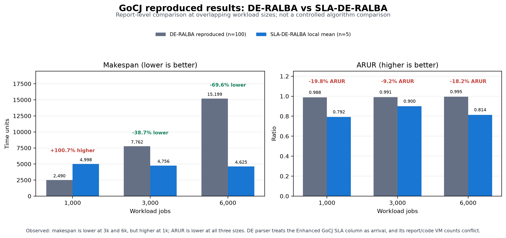

# NEW-SLA-DE-RALBA

Executable SLA-DE-RALBA source and GoCJ reproduction runner. The code is based on the author's public Bitbucket repository; the upstream source archive and file-by-file provenance are included in this repository.

## Build and run GoCJ

Requirements: JDK 17 and Maven 3.x. Download the Enhanced GoCJ CSVs from [Mendeley Data](https://data.mendeley.com/datasets/r93dfjvvv6/5) and place them in `GoCJ_v1/Enhanced_GoCJ/` as `GoCJ_Dataset_1000.csv` through `GoCJ_Dataset_6000.csv`.

From the repository root, run all six workload sizes five times:

```powershell
.\dynamic_sla-de-ralba\run_gocj_reproduction.ps1
```

A quick run:

```powershell
.\dynamic_sla-de-ralba\run_gocj_reproduction.ps1 -Sizes 1000 -Repeats 1
```

The runner writes run-level CSV rows and per-run XLSX workbooks under `dynamic_sla-de-ralba/results/`. It reports Makespan, ARUR, Throughput, Energy, Execution Time, Execution Cost, and JRR. The runner records the local implementation's values; matching the paper's values depends on using the same input interpretation, VM configuration, and metric definitions.

## GoCJ comparison snapshot

At shared workload sizes, the report means show lower SLA-DE-RALBA makespan at 3,000 and 6,000 jobs, higher makespan at 1,000 jobs, and lower ARUR at all three sizes. The chart, comparison table, SLA run logs, and paper figure data are in [`dynamic_sla-de-ralba/report/GOCJ_COMPARISON.md`](dynamic_sla-de-ralba/report/GOCJ_COMPARISON.md) and its linked `results/` files.



The comparison is descriptive: DE-RALBA input parsing and checked VM configuration differ from the SLA-DE-RALBA run, as documented in the report.
## Source provenance

- Upstream repository: [sladeralba_26/dynamic-sla-de-ralba](https://bitbucket.org/sladeralba_26/dynamic-sla-de-ralba/src/main/).
- The original archive is retained at `dynamic_sla-de-ralba/upstream/sladeralba-bitbucket-main.zip`.
- Six supporting Java files are byte-identical to the archive. `SLADERALBA.java` is modified in this project. `HcspCsvAdapter.java` and `HcspVmProfileFactory.java` were added in this project.
- See [`SOURCE_PROVENANCE.md`](SOURCE_PROVENANCE.md) for the exact file list and scope of local changes.

HCSP helper code remains in the source tree because the modified entry point references it. No HCSP experiment data or HCSP comparison claims are included here.

