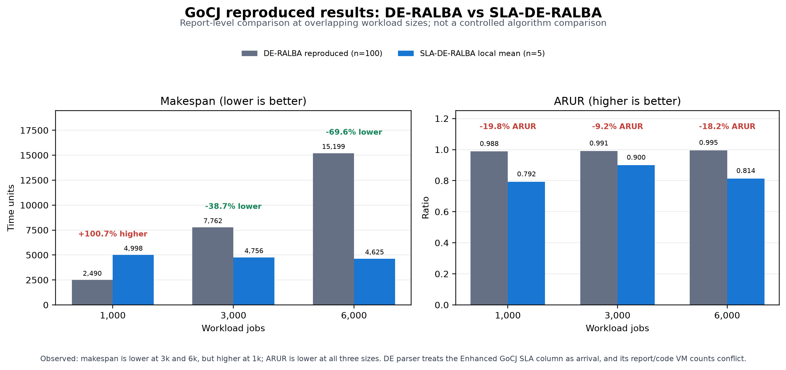

# GoCJ comparison report

## Scope and result

This report places the reproduced GoCJ means from the DE-RALBA validation report beside the local SLA-DE-RALBA means at the three shared workload sizes: 1,000, 3,000, and 6,000 jobs. It is a descriptive comparison. The available evidence does not establish a controlled, like-for-like algorithm improvement.

| Jobs | DE-RALBA makespan (100-run report mean) | SLA-DE-RALBA makespan (5-run mean) | Makespan change | DE-RALBA ARUR | SLA-DE-RALBA ARUR | ARUR change |
|---:|---:|---:|---:|---:|---:|---:|
| 1,000 | 2,490.00 | 4,998.08 | +100.73% (higher / worse) | 0.988 | 0.792399 | -19.80% (lower / degraded) |
| 3,000 | 7,761.80 | 4,755.62 | -38.73% (lower / improved) | 0.991 | 0.899735 | -9.21% (lower / degraded) |
| 6,000 | 15,199.40 | 4,625.15 | -69.57% (lower / improved) | 0.995 | 0.813961 | -18.19% (lower / degraded) |

## What improved and what declined

- **Makespan:** SLA-DE-RALBA's reported local mean is lower by 38.7% at 3,000 jobs and 69.6% at 6,000 jobs. At 1,000 jobs it is 100.7% higher, so the result regresses at that size.
- **ARUR:** the SLA-DE-RALBA values are lower by 19.8%, 9.2%, and 18.2% at 1,000, 3,000, and 6,000 jobs. ARUR is the metric that declines at every shared size.
- **Other metrics:** the DE-RALBA report does not provide corresponding reproduced means for throughput, energy, execution time, execution cost, or JRR; these are not compared here.

## Limits on interpretation

1. The DE-RALBA report summarizes 100 runs, while the SLA-DE-RALBA log has five repetitions per workload and the five values are identical. The DE-RALBA raw run log was not present in the workspace, so its mean cannot be recomputed here.
2. Both reports describe 30 hosts and 50 GoCJ VMs, but the checked DE-RALBA source snapshot declares 16 hosts and 15 VMs. The exact runtime configuration that produced the DE-RALBA report means is therefore unresolved.
3. The local Enhanced GoCJ input has three columns (`MI,SLA,arrival`). The checked DE-RALBA loader reads only columns 1 and 2 as `length,arrival`, so its local parser treats SLA as arrival. The SLA-DE-RALBA loader uses the three fields separately. Effective inputs are not equivalent.
4. The compared reports do not establish that ARUR is calculated and aggregated identically.

For these reasons, the percentages describe the two sets of reported local outputs. They should not be presented as proof that one algorithm caused the observed change under a controlled experiment.

## Data and provenance

- DE-RALBA means are transcribed from `DE-RALBA_Paper_Validation_Report.docx`, GoCJ comparison table; that report states 100 runs per configuration. The extracted summary is `../results/de_ralba_reproduced_means_from_report.csv`.
- SLA-DE-RALBA run rows come from `../results/sla-deralba-gocj-20261029-105546.csv`; the six workload means are in `../results/sla_deralba_gocj_mean_5_runs.csv`.
- Paper Figure 3–10 values and SLA-DE-RALBA-versus-paper deltas are retained as separate sources in the adjacent CSV files.
- HCSP results are excluded because the local adapter input is not equivalent to the paper's unpublished HCSP input.
